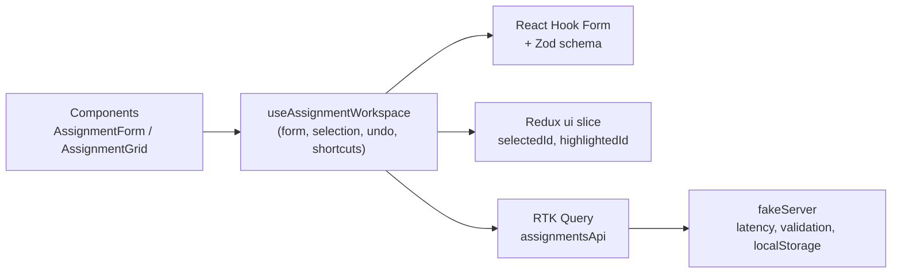

pbpaste > README.md<div align="center">

# Assignment Manager

**A single-page React + TypeScript CRUD app, built like a product instead of a form.**


</div>

Enter records, view them in a data grid, and edit the ones marked as updatable. Everything from the original brief is implemented, plus the engineering and UX details that usually separate a demo from a product: undo, a dirty-form guard, keyboard shortcuts, dark mode, TR/EN, a fake API layer with optimistic updates, tests and CI.

## Table of contents

- [Quick start](#quick-start)
- [Requirements coverage](#requirements-coverage)
- [Beyond the brief](#beyond-the-brief)
- [Keyboard shortcuts](#keyboard-shortcuts)
- [Architecture](#architecture)
- [Tech stack](#tech-stack)
- [Scripts](#scripts)
- [Testing](#testing)
- [Quality gates and CI](#quality-gates-and-ci)
- [Docker](#docker)
- [Design decisions and trade-offs](#design-decisions-and-trade-offs)
- [Accessibility](#accessibility)
- [Known limitations and roadmap](#known-limitations-and-roadmap)

## Quick start

Requires **Node.js 22.12+** (an `.nvmrc` is included, so `nvm use` picks the right version).

```bash
npm install
npm run dev        # http://localhost:5173
```

On first launch three demo records are loaded (one of them is not updatable) so every state of the grid is visible immediately. To reset, clear the site's `localStorage` in the browser.

## Requirements coverage

| #     | Requirement                                                                                         | Status |
| ----- | --------------------------------------------------------------------------------------------------- | ------ |
| 1a    | **Code**: first 2 characters letters, last 3 digits, max length 5, required, pattern tip on hover   | ✅     |
| 1b    | **Name**: max length 12, required                                                                   | ✅     |
| 1c    | **Assign Date**: `DD/MM/YYYY`, required, pattern tip on hover                                       | ✅     |
| 1d    | **Is Updatable?** checkbox                                                                          | ✅     |
| 2     | **Save/Update** and **Clean** buttons, with icons from the UI library                               | ✅     |
| 3     | Data grid component                                                                                 | ✅     |
| E1    | Save populates the grid                                                                             | ✅     |
| E2    | Clicking a row fills the inputs                                                                     | ✅     |
| E3    | Rows without "Is Updatable?" are grey and not clickable                                             | ✅     |
| E4    | Clicking an updatable row turns **Save** into **Update**                                            | ✅     |
| E5    | **Update** modifies the record in the grid                                                          | ✅     |
| E6    | **Clean** clears all four inputs and the button reads **Save** again                                | ✅     |
| E7    | Generic input component (`FormTextField`: name, pattern, tips, disabled, maxLength, transform, ...) | ✅     |
| E8    | Generic button component (`ActionButton`: label, action, tips, color, disabled, icon, ...)          | ✅     |
| E9-10 | UI library with icons (MUI) and UI/UX best practices                                                | ✅     |

Delivery: meaningful, incremental conventional commits; this README; Docker and docker-compose; a fake API layer instead of an external service.

## Beyond the brief

**Engineering**

- **ISO dates in the domain.** Dates are stored as `YYYY-MM-DD` and shown as `DD/MM/YYYY`. All conversion happens in one place (`utils/adapters.ts`), and sorting by date is correct.
- **Zod schema as the single source of validation truth.** `schema/assignmentSchema.ts` drives `react-hook-form` through `zodResolver`, including uniqueness of the code.
- **Logic in a hook, components stay presentational.** `useAssignmentWorkspace` owns form state, selection, dirty guard, undo and shortcuts. Selectors are memoized with `createSelector`.
- **Fake API with RTK Query.** Simulated latency, a server-side duplicate-code error, **optimistic updates with automatic rollback**, and loading/error states. Swapping in a real REST API only touches `api/fakeServer.ts`.
- **26 tests** (Vitest + React Testing Library) mapped to the brief's scenarios plus the UX extras.
- **Quality gates:** ESLint 10 (flat config), Prettier, Husky, lint-staged, commitlint, GitHub Actions.
- **Production hygiene:** `ErrorBoundary`, vendor chunk splitting (no bundle-size warning), non-root nginx in Docker with security headers and a read-only compose service.

**UI/UX**

- **Dirty-form guard.** Switching rows with unsaved changes opens a confirmation dialog; the form shows an "Unsaved changes" chip; closing the tab triggers the browser warning.
- **Clear edit mode.** A banner shows which record is being edited and how to cancel. On mobile the page scrolls to the form when a row is selected, and focus returns to the first field after saving.
- **Undo** for Save, Update and Clean via the snackbar.
- **Disabled rows are not conveyed by colour alone.** They also get a lock icon, a hover explanation and `aria-disabled`.
- **Instant feedback.** Live character counter on Name (`8/12`), automatic upper-casing of Code, automatic `/` mask for the date, plus a calendar picker (typing still works).
- **Row highlight** after save/update, respecting `prefers-reduced-motion`.
- **Grid:** column sorting, search, "updatable only" filter, pagination, empty and no-result states, skeleton loading, retry on error, `aria-live` result announcements.
- **Dark mode** and **TR/EN** language switch. Preferences persist; the first visit follows the system setting.

## Keyboard shortcuts

| Key               | Action                                                      |
| ----------------- | ----------------------------------------------------------- |
| `Ctrl/Cmd + S`    | Save or update the current record                           |
| `Esc`             | Cancel editing (asks for confirmation if there are changes) |
| `Tab`             | Move between fields and updatable rows                      |
| `Enter` / `Space` | Select the focused row for editing                          |

## Architecture



```
src/
  api/          fakeServer (simulated backend), assignmentsApi (RTK Query)
  components/   FormTextField, ActionButton, AssignmentForm, AssignmentGrid, ConfirmDialog, ...
  hooks/        useAssignmentWorkspace
  i18n/         TR/EN translations and provider
  schema/       Zod validation schema
  store/        Redux store, ui slice, selectors
  theme/        MUI theme and dark-mode provider
  utils/        date helpers, form/domain adapters, validation constants
  test/         test setup and helpers
```

Each kind of state lives where it fits best: **server state** in RTK Query, **UI state** (selected and highlighted row) in a small Redux slice, **form state** in React Hook Form.

## Tech stack

| Technology                                  | Version                                             |
| ------------------------------------------- | --------------------------------------------------- |
| React / React DOM                           | 19.x                                                |
| TypeScript                                  | 6.0.x (typescript-eslint does not support TS 7 yet) |
| Redux Toolkit (with RTK Query), React-Redux | 2.x, 9.x                                            |
| React Hook Form, @hookform/resolvers        | 7.x, 5.x                                            |
| Zod                                         | 4.x                                                 |
| MUI (Material UI) and MUI Icons             | 7.x                                                 |
| Vite                                        | 8.x                                                 |
| Vitest, Testing Library                     | 5.x                                                 |
| ESLint, Prettier                            | 10.x, 3.x                                           |
| Node.js                                     | 22 LTS (`>=22.12`)                                  |

## Scripts

| Command                | Description                         |
| ---------------------- | ----------------------------------- |
| `npm run dev`          | Start the dev server                |
| `npm run build`        | Type-check and build for production |
| `npm run preview`      | Preview the production build        |
| `npm test`             | Run the test suite once             |
| `npm run test:watch`   | Run tests in watch mode             |
| `npm run lint`         | ESLint                              |
| `npm run typecheck`    | TypeScript, no emit                 |
| `npm run format`       | Format with Prettier                |
| `npm run format:check` | Check formatting                    |

## Testing

26 tests across three layers:

- **Utilities** (`date.test.ts`): ISO/display conversion, real-calendar validation, input mask.
- **Schema** (`assignmentSchema.test.ts`): code pattern, name length, impossible dates, duplicate codes (editing a record may keep its own code).
- **Integration** (`App.test.tsx`): user-level flows through the real UI, store and fake API.
  - Brief scenarios: constraints, hover tips, validation, Save fills the grid, disabled rows, row click fills inputs, Save becomes Update, Update changes the row, Clean resets.
  - UX extras: duplicate rejection, dirty-form dialog, `Esc`, `Ctrl+S`, undo of save and update, search and filter.

## Quality gates and CI

| Stage               | What runs                                                               |
| ------------------- | ----------------------------------------------------------------------- |
| `pre-commit`        | lint-staged: ESLint and Prettier on staged files                        |
| `commit-msg`        | commitlint: Conventional Commits (`feat:`, `fix:`, `docs:`, ...)        |
| `pre-push`          | type-check and tests                                                    |
| GitHub Actions (CI) | format check, lint, type-check, tests, build, then a Docker image build |

## Docker

```bash
docker compose up --build   # http://localhost:8080
```

Multi-stage build (Node 22 builder, then `nginx-unprivileged`). The container runs as a non-root user, serves on port 8080 with basic security headers, and the compose service is read-only with `no-new-privileges`.

## Design decisions and trade-offs

- **ISO dates, display format at the edge.** Storing `DD/MM/YYYY` strings would make sorting and filtering wrong. The form model and domain model are therefore different types, converted in one adapter.
- **One validation source.** Rules live in the Zod schema. `FormTextField` still accepts `pattern`, `required` and `maxLength` as props (as the brief asks) and applies them as RHF rules when used without a resolver and as HTML attributes always; with a resolver the schema is authoritative.
- **Imperative selection-to-form sync.** Selecting a row calls `reset()` directly instead of syncing through effects. This keeps the dirty guard and undo predictable.
- **Fake API behind RTK Query.** Loading, error and optimistic-update behaviour are exercised for real, and migrating to a REST backend means replacing `fakeServer` with `fetchBaseQuery`.
- **Server enforces uniqueness too.** The client check can race; a `DUPLICATE_CODE` error from the server is mapped back onto the Code field.
- **TypeScript 6.0, not 7.** Pinned because `typescript-eslint` does not support TS 7 yet; revisit when it does.

## Accessibility

- Every input has a visible label, helper text and an error message tied to the field.
- Grid rows are keyboard reachable; disabled rows are removed from the tab order and carry `aria-disabled`.
- Status is never colour-only: lock icon plus text for non-updatable rows.
- Results and save/undo messages are announced through live regions.
- Animations respect `prefers-reduced-motion`; dark mode follows the system by default.

## Known limitations and roadmap

- Record ids use `crypto.randomUUID()`, which browsers only expose on `localhost` and HTTPS. Opening the dev server over a plain-HTTP LAN address would break saving.
- There is no delete UI yet; `deleteAssignment` exists in the API layer and is currently used only by undo.
- Next steps: a real REST backend with MSW-based integration tests, Playwright end-to-end tests, Storybook for the components, virtualized grid with server-side pagination.
